# Parallel & GPU Computing Lab — Experiment 2

## 1. Experiment Overview
This experiment studies multithreaded programming using two prominent parallel programming libraries: **POSIX Threads (Pthreads)** and **OpenMP**. The goal is to understand how a single process can be split into multiple execution paths (threads) to run concurrently. Multithreading and parallel programming are essential in modern computing to fully utilize multi-core processors, reducing execution time and increasing computational efficiency for large workloads.

## 2. Objectives
The core objectives covered by this experiment are:
- **Thread creation:** How to spawn new threads.
- **Thread management:** Identifying and handling multiple threads concurrently.
- **Work distribution:** Dividing a large problem into smaller chunks for parallel execution.
- **Race conditions:** Demonstrating what happens when threads access shared memory without coordination.
- **Synchronization:** Using mechanisms like mutexes and critical sections to prevent data corruption.
- **Thread coordination:** Synchronizing thread execution states (e.g., barriers).
- **Performance improvement:** Measuring the actual execution speedup and efficiency gained by utilizing multiple threads.

## 3. Technologies and Environment
The experiment was conducted using the following technologies:
- **C** (Programming Language)
- **GCC** (GNU Compiler Collection)
- **POSIX Pthreads** (Low-level thread API)
- **OpenMP** (High-level compiler directives API)
- **Linux / WSL Ubuntu** (Development and execution environment)
- **Git / GitHub** (Version control and project management)

## 4. Project Structure

The repository is structured as follows:

```
graphs/         # Performance-analysis graphs generated from execution data
screenshots/    # Terminal output screenshots corresponding to each experiment step
src/            # Source code directory
  pthread/      # C programs utilizing the Pthreads library (Part A)
  openmp/       # C programs utilizing the OpenMP library (Part B)
results/        # CSV files containing the measured performance data (Part C)
```

## 5. Part A — Pthreads

### 5.1 Thread Creation
**Source:** [src/pthread/thread1.c](src/pthread/thread1.c)  
**Output:** 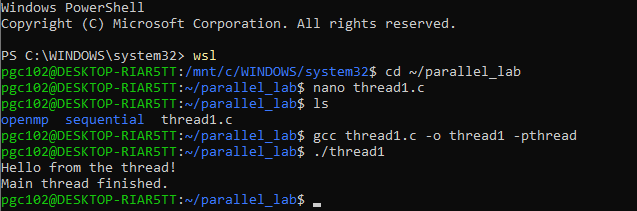

This program demonstrates the basic lifecycle of a thread. The main thread spawns a new thread using `pthread_create()`, passing it a function `thread_function` to execute. After creation, the main thread uses `pthread_join()` to pause and wait until the newly created thread finishes its execution before proceeding.

### 5.2 Multiple Threads
**Source:** [src/pthread/thread2.c](src/pthread/thread2.c)  
**Output:** 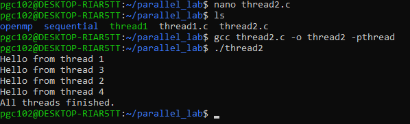

Here, we create and manage multiple threads using an array of `pthread_t` identifiers. In a loop, `pthread_create()` is called to spawn four distinct threads, passing each a unique thread ID as an argument. The main thread then waits for all four threads to complete via `pthread_join()`. The output order of thread execution varies because the operating system's thread scheduler decides when each thread runs.

### 5.3 Work Distribution
**Source:** [src/pthread/thread_sum.c](src/pthread/thread_sum.c)  
**Output:** 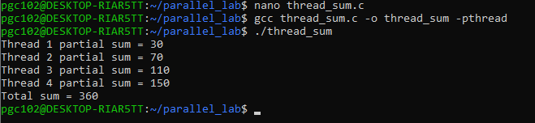

This program demonstrates how a workload is divided among threads. We have a shared array of numbers. Instead of one thread summing the entire array, the work is split into four chunks. Each thread receives a unique ID, calculates its start and end indices, computes a partial sum, and saves it in a shared `partial_sum` array. The main thread later combines these partial sums to calculate the final total sum.

### 5.4 Race Condition
**Source:** [src/pthread/race.c](src/pthread/race.c)  
**Output:** 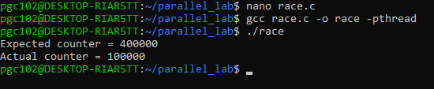

A race condition occurs when multiple threads attempt to read and write to the same shared variable concurrently without synchronization. In this program, four threads execute a loop to increment a shared `counter` 100,000 times each. Because `counter++` is not an atomic operation (it involves reading, incrementing, and writing back), threads overwrite each other's work (lost updates). As a result, the final value is unpredictable and significantly less than the expected 400,000.

### 5.5 Mutex Synchronization
**Source:** [src/pthread/mutex.c](src/pthread/mutex.c)  
**Output:** 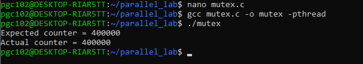

To fix the race condition from the previous example, we introduce a **mutex** (mutual exclusion). By surrounding the shared counter increment with `pthread_mutex_lock()` and `pthread_mutex_unlock()`, we create a **critical section**. The mutex acts as a key; only one thread can hold it at a time. This guarantees that threads safely update the shared counter one by one, producing the correct expected output of 400,000.

---

## 6. Part B — OpenMP

### 6.1 Parallel Region
**Source:** [src/openmp/omp1.c](src/openmp/omp1.c)  
**Output:** 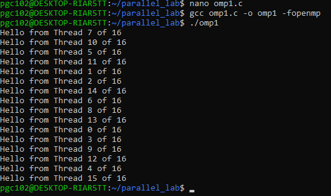

OpenMP abstracts thread management. By using the compiler directive `#pragma omp parallel`, OpenMP automatically spawns a team of threads to execute the block of code that follows. Inside the region, we use `omp_get_thread_num()` to identify the current executing thread and `omp_get_num_threads()` to get the total team size.

### 6.2 Work Sharing and Reduction
**Source:** [src/openmp/omp_sum.c](src/openmp/omp_sum.c)  
**Output:** 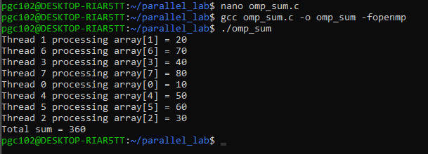

We can divide loop iterations automatically using `#pragma omp parallel for`. The `reduction(+:total_sum)` clause elegantly solves the work distribution and partial sum aggregation problem. It gives each thread a private copy of `total_sum`, calculates the partial sums, and safely combines them into the global `total_sum` at the end of the loop, entirely avoiding manual chunking and unsafe shared updates.

### 6.3 Race Condition
**Source:** [src/openmp/omp_race.c](src/openmp/omp_race.c)  
**Output:** 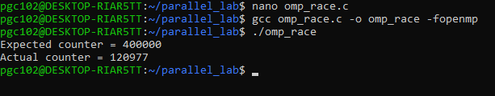

Even though OpenMP manages thread creation, shared variables can still experience race conditions if they are not explicitly protected. This program intentionally increments a shared counter inside a `#pragma omp parallel` region without a reduction or critical section, resulting in lost updates and an incorrect final counter value.

### 6.4 Critical Synchronization
**Source:** [src/openmp/omp_critical.c](src/openmp/omp_critical.c)  
**Output:** 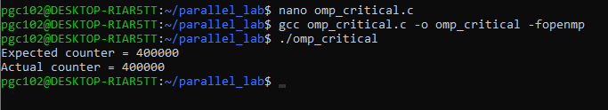

This program resolves the OpenMP race condition using the `#pragma omp critical` directive. When threads encounter a critical section, they are forced to execute it sequentially, one at a time. This guarantees safe updates to the shared counter, successfully reaching the expected 400,000.

### 6.5 Barrier Synchronization
**Source:** [src/openmp/omp_barrier.c](src/openmp/omp_barrier.c)  
**Output:** 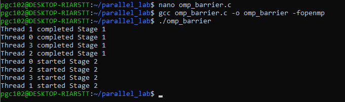

Sometimes threads must wait for others to catch up before moving to the next phase of work. The `#pragma omp barrier` directive creates a synchronization point. Every thread must reach this barrier before any single thread is allowed to continue past it. This coordinates threads between distinct execution stages (e.g., ensuring Stage 1 is fully complete before Stage 2 begins).

---

## 7. Part C — Performance Analysis
To determine whether multiple threads actually make a program faster, a large computational workload (summing 1,000,000,000 elements) was tested using sequential, Pthreads, and OpenMP execution modes. The results are logged in [results/performance_results.csv](results/performance_results.csv).

### 7.1 Sequential Baseline
**Sequential Baseline: 1.854394 seconds**  
This represents the time taken by a single-threaded execution to complete the workload. It serves as the fundamental reference point against which the parallel executions are measured to calculate speedup.

### 7.2 Pthreads Performance
Actual measured execution times for the Pthreads implementation:

| Threads | Time (s) |
|---:|---:|
| 1 | 1.856472 |
| 2 | 0.914650 |
| 4 | 0.483502 |
| 6 | 0.441496 |
| 16 | 0.359917 |

### 7.3 OpenMP Performance
Actual measured execution times for the OpenMP implementation:

| Threads | Time (s) |
|---:|---:|
| 1 | 1.853107 |
| 2 | 0.910422 |
| 4 | 0.480552 |
| 6 | 0.424741 |
| 16 | 0.321949 |

### 7.4 Speedup
**Speedup = Sequential Time / Parallel Time**  
Speedup indicates how much faster the parallel program executes compared to the sequential baseline. For instance, a speedup of 2 means the program ran twice as fast.

### 7.5 Efficiency
**Efficiency = Speedup / Number of Threads × 100**  
Efficiency measures how effectively the available threads contribute to the overall speedup. An efficiency of 100% means perfect linear scaling (e.g., 4 threads yielding a 4x speedup).

### 7.6 Complete Performance Table
The following table presents the exact measured and calculated performance metrics:

| Threads | Pthreads Time | OpenMP Time | Pthreads Speedup | OpenMP Speedup | Pthreads Efficiency | OpenMP Efficiency |
|---:|---:|---:|---:|---:|---:|---:|
| 1 | 1.856472 | 1.853107 | 0.9989 | 1.0007 | 99.89 | 100.07 |
| 2 | 0.914650 | 0.910422 | 2.0274 | 2.0369 | 101.37 | 101.84 |
| 4 | 0.483502 | 0.480552 | 3.8353 | 3.8589 | 95.88 | 96.47 |
| 6 | 0.441496 | 0.424741 | 4.2003 | 4.3659 | 70.00 | 72.77 |
| 16 | 0.359917 | 0.321949 | 5.1523 | 5.7599 | 32.20 | 36.00 |

---

## 8. Graphical Analysis

### 1. Execution Time vs Threads
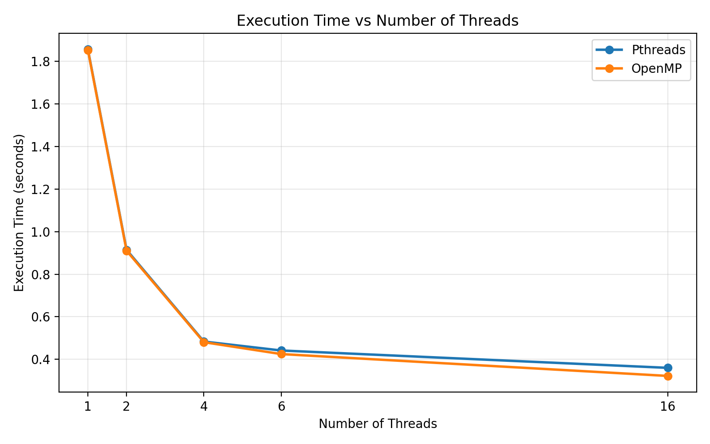  
This graph illustrates the dramatic drop in execution time as the number of threads increases from 1 to 4, with diminishing returns observed as thread counts push higher.

### 2. Speedup vs Threads
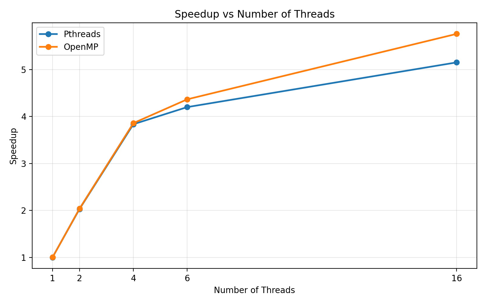  
Demonstrates the speedup factor gained relative to the sequential baseline. It shows nearly linear scaling up to 4 threads before the curve starts to flatten.

### 3. Efficiency vs Threads
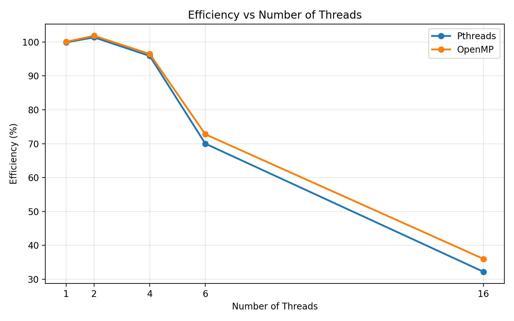  
Shows the drop in thread utilization efficiency. While low thread counts (1-4) maintain >95% efficiency, jumping to 16 threads drops efficiency to the 30% range.

### 4. Pthreads vs OpenMP
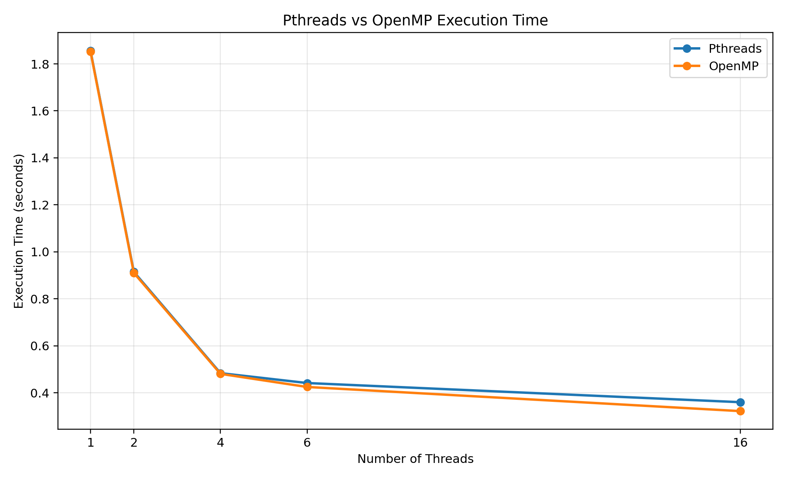  
A direct comparison showing that both libraries scale very similarly on this particular workload, with OpenMP occasionally showing a slight edge at higher thread counts.

### 5. Race Condition vs Synchronization
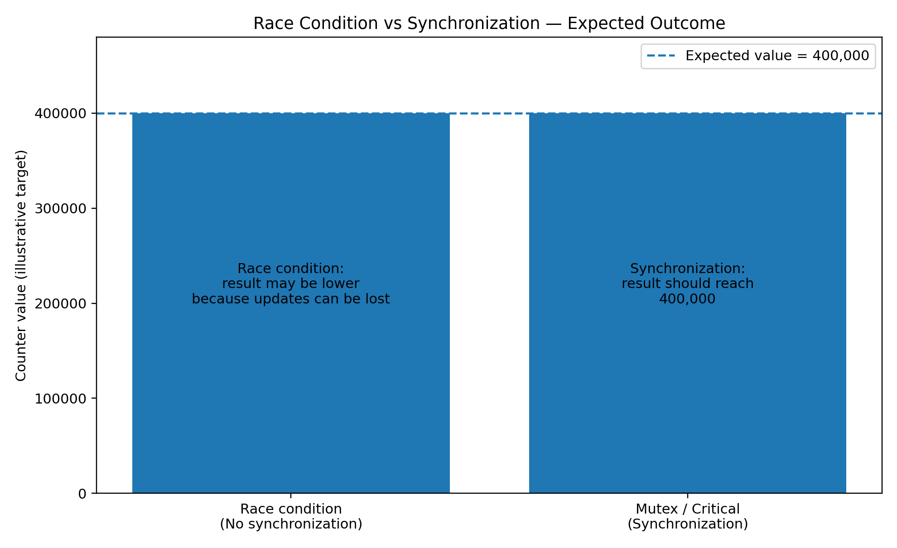  
*(Note: This is an illustrative expected-outcome graph.)* It visually represents how lack of synchronization leads to unpredictable, incorrect lost updates, whereas proper synchronization achieves the stable, expected target.

### 6. Ideal vs Measured Execution Time
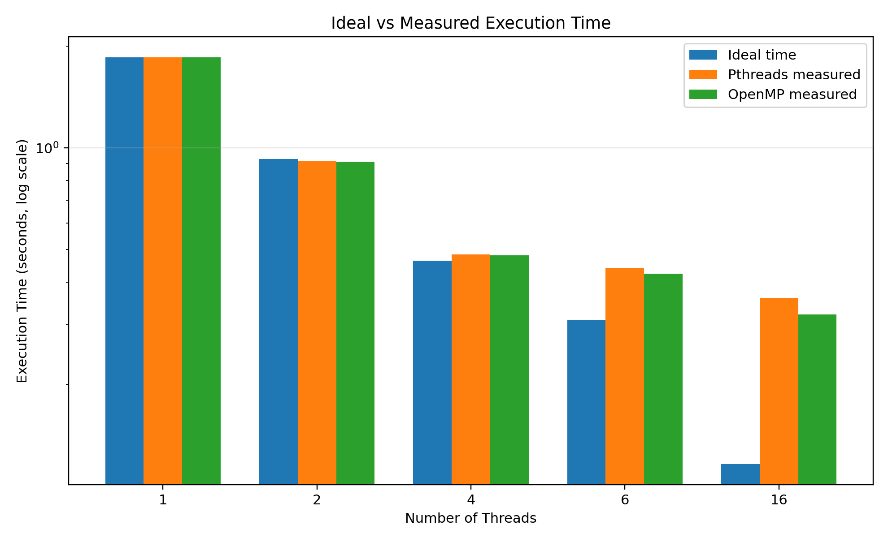  
Highlights the gap between a theoretical perfectly linear speedup (ideal) and the actual measured reality, visually demonstrating the impact of parallel overhead.

### 7. Performance Summary
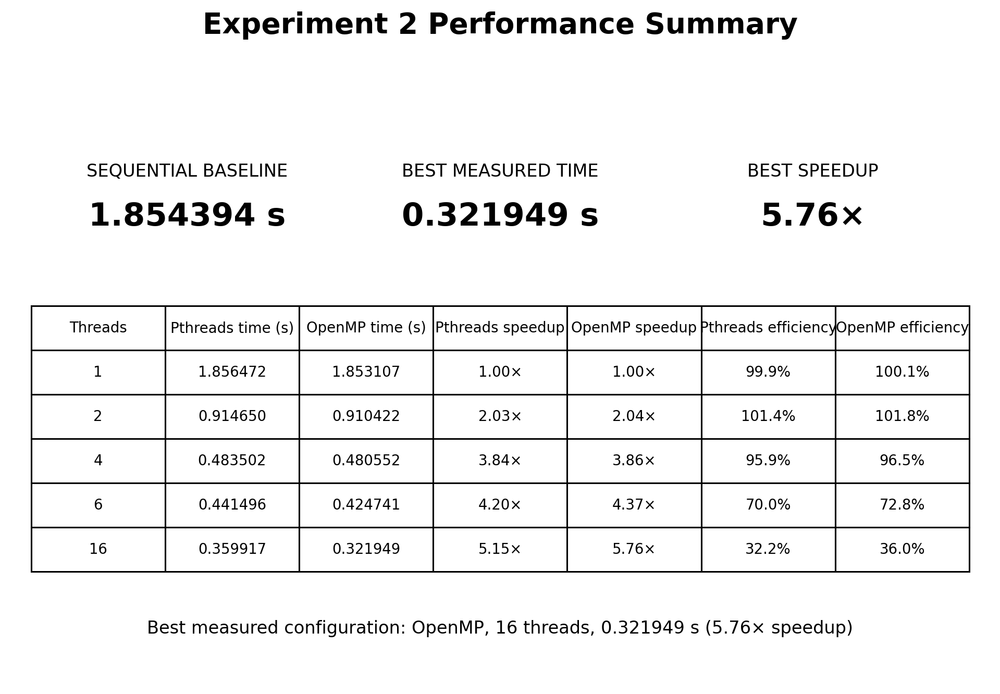  
A composite summary consolidating execution time, speedup, and efficiency metrics into a single overarching view of the experiment's performance phase.

---

## 9. Pthreads vs OpenMP

| Feature | Pthreads | OpenMP |
|---|---|---|
| **Programming Model** | Low-level C library | High-level compiler directives |
| **Thread Management** | Explicit (`pthread_create`, `pthread_join`) | Implicit (`#pragma omp parallel`) |
| **Ease of Use** | Complex (requires manual thread arrays and argument casting) | Simple (handled via pragmas) |
| **Synchronization** | Manual Mutexes (`pthread_mutex_lock`) | Directives (`#pragma omp critical`) |
| **Work Sharing** | Manual index calculation and chunking | Automatic (`#pragma omp parallel for`) |
| **Typical Usage** | Fine-grained, custom thread control (e.g., OS dev, servers) | Loop-heavy scientific and numerical computing |
| **Relevant Constructs** | `pthread_create`, `pthread_join`, `pthread_mutex_t` | `omp parallel`, `omp parallel for`, `reduction`, `critical` |

---

## 10. Why 16 Threads Does Not Give 16× Speedup
Looking at our data, 16 threads only yielded a ~5.7x speedup, operating at ~36% efficiency. This happens because parallel execution is not perfectly linear due to inherent overheads:
- **Thread Management Overhead:** Creating, managing, and destroying threads takes operating system time.
- **Synchronization Overhead:** Locks (like mutexes or critical sections) force threads to wait, effectively serializing parts of the program.
- **Serial Portions:** According to Amdahl's Law, the speedup is limited by the portion of the code that cannot be parallelized.
- **Memory and Cache Effects:** Multiple threads competing for memory bandwidth or invalidating each other's cache lines (false sharing) can degrade performance.
- **Hardware Limitations:** If the CPU executing this workload physically lacks 16 dedicated hardware cores, the OS must context-switch between threads, which severely limits scaling.

---

## 11. Important Concepts
- **Thread:** The smallest sequence of programmed instructions that can be managed independently by a scheduler.
- **Process:** An executing instance of a program; a process can contain multiple threads that share its memory space.
- **Pthread:** A standard low-level C API for creating and managing threads.
- **OpenMP:** An API that supports multi-platform shared-memory multiprocessing programming in C/C++.
- **Parallel Region:** A block of code executed by multiple threads simultaneously.
- **Work Sharing:** Distributing iterations of a loop among available threads.
- **Race Condition:** A flaw occurring when the timing of threads affects the correctness of shared data operations.
- **Critical Section:** A block of code accessing a shared resource that must not be concurrently executed by more than one thread.
- **Mutex:** A "mutual exclusion" lock used to protect critical sections in Pthreads.
- **Critical Directive:** The OpenMP equivalent of a mutex, forcing sequential execution of a code block.
- **Barrier:** A synchronization point where all threads must stop and wait until all other threads reach the same point.
- **Reduction:** A safe OpenMP mechanism to aggregate partial results calculated by multiple threads into a single global result.
- **Speedup:** The ratio of sequential execution time to parallel execution time.
- **Efficiency:** The ratio of speedup to the number of threads used, representing hardware utilization effectiveness.
- **Synchronization:** Coordinating the execution timing of multiple threads to ensure correctness.
- **Thread Overhead:** The processing time required by the OS and runtime libraries to create, manage, and coordinate threads.

---

## 12. Viva Questions

**Q: What is a thread?**  
A: A thread is a lightweight, independent execution path within a process.

**Q: What is `pthread_create()`?**  
A: A Pthreads function used to spawn a new, additional thread that executes a specified function.

**Q: Why is `pthread_join()` required?**  
A: It forces the calling thread (usually main) to wait until the target thread finishes, preventing the program from terminating prematurely.

**Q: What is a race condition?**  
A: A situation where multiple threads read and write to shared data simultaneously without coordination, leading to corrupted or unpredictable results.

**Q: What is a critical section?**  
A: A specific segment of code where shared resources are accessed and modified, requiring protection from simultaneous thread access.

**Q: Why does the race condition produce an incorrect result?**  
A: Because a modification like `counter++` is not atomic. If two threads read the value simultaneously, they will both increment the same old value, losing one of the updates.

**Q: What does a mutex do?**  
A: It acts as a lock. A thread must acquire the mutex before entering a critical section, locking out other threads until the mutex is unlocked.

**Q: What is OpenMP?**  
A: A high-level API that uses compiler directives (pragmas) to easily write multithreaded applications in shared-memory environments.

**Q: What does `#pragma omp parallel` do?**  
A: It tells the compiler to spawn a team of threads to execute the enclosed block of code concurrently.

**Q: What is `reduction` in OpenMP?**  
A: A clause that gives each thread a private copy of a variable to update, and safely aggregates all private copies into the global variable at the end of the loop.

**Q: What does `critical` do?**  
A: It marks a block of code in OpenMP so that it is executed by only one thread at a time.

**Q: What does `barrier` do?**  
A: It forces all threads in a team to wait at a specific point in the code until every thread has reached that point.

**Q: What is speedup?**  
A: A metric showing how much faster a parallel execution is compared to the sequential baseline (Sequential Time / Parallel Time).

**Q: What is efficiency?**  
A: A metric showing how effectively threads are utilized (Speedup / Number of Threads).

**Q: Why is speedup not linear?**  
A: Due to overheads like thread creation, scheduling, synchronization locks, memory bandwidth limits, and serial sections of code.

**Q: Why doesn't 16 threads produce 16× speedup?**  
A: Because of diminishing returns; overhead scales up with more threads, hardware core limits are reached, and thread context-switching slows down the system.

**Q: Difference between Pthreads and OpenMP?**  
A: Pthreads is a low-level API requiring manual thread and work management. OpenMP is a high-level API using pragmas to automatically handle thread creation and loop distribution.

---

## 13. Conclusion
This experiment provided hands-on experience in multithreaded programming using both Pthreads and OpenMP. We learned that while threads significantly improve performance by splitting workloads, they introduce risks like **race conditions** when shared data is accessed concurrently. We explored how to resolve these issues using **synchronization** mechanisms like mutexes and critical sections.

The performance measurement phase highlighted that parallel programming is highly effective, yielding up to a ~5.7x **speedup** on this workload. However, it also practically demonstrated that **efficiency** drops at high thread counts due to synchronization and management overhead, proving that throwing infinite threads at a problem does not yield infinite speedup.
